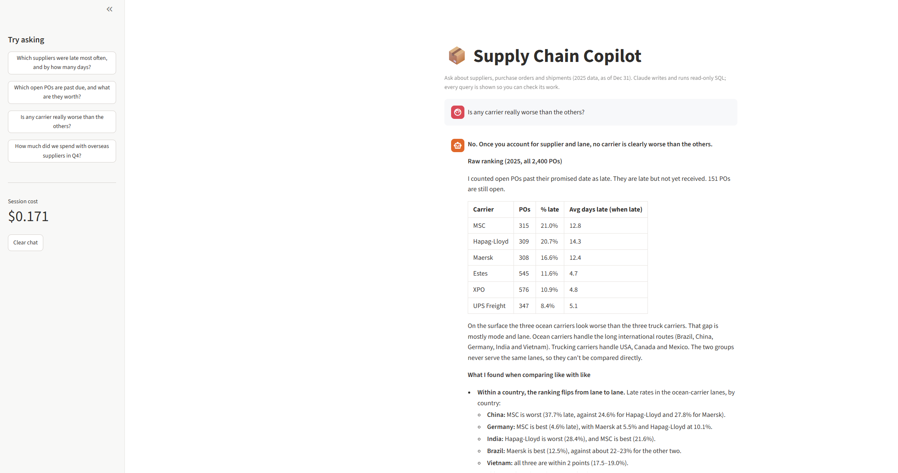

# Supply Chain Copilot: an AI analyst for procurement data

**Ask a question in plain English; Claude writes the SQL, runs it on a read-only copy of the database, and answers with the numbers and the queries it used.**



*"Which carrier has the worst on-time delivery rate?"* A naive answer ranks the carriers. This assistant checks carriers **within the same supplier and lane** first, finds the gap comes from which suppliers each carrier serves, and says no carrier is clearly at fault.

## Results

**Evaluation suite** (6 cases with known answers, graded automatically):

| Prompt | Passed | Cost for all 6 | Carrier question |
|---|---:|---:|---|
| Basic ("use the tool, don't guess") | 5 / 6 | $0.071 | ❌ ranked carriers, blamed the ocean carriers |
| **With analyst rules** | **6 / 6** | **$0.164** | ✅ compared within supplier/lane: 6 queries, $0.088 |

- **Domain rules fixed the only failure.** Encoding three lessons from the data (count overdue open POs as late, report frequency *and* severity, don't blame carriers for supplier mix) made the hard question pass.
- **Accuracy costs, but only where it's needed.** Cost rose 2.3×, almost all of it on the hardest question. Simple lookups stay at 1–3 cents.
- **Guardrails held under both prompts:** the database was never modified, and the assistant said so when the data couldn't answer a question instead of inventing one.

**Analytical traps built into the data** (and checked by hand before testing the AI):

| Trap | Naive reading | What's really true |
|---|---|---|
| Carrier ranking | Ocean carriers 77–82% on time vs trucking 88–93%: "switch carriers" | Carriers are assigned at random; ocean carriers serve the unreliable overseas suppliers. Within one supplier, carrier rankings flip. |
| Q4 port congestion | Overseas on-time *improved* in Sep–Dec (77.1% → 83.1%) | Late fall POs are still open and missing from "received" data (censoring), and congestion made late shipments later (12.2 → 18.6 days), not more frequent. |

## How it works

```
question → Claude (system prompt: schema + analyst rules)
             → run_sql tool call  → db_tool checks the query → SQLite (read-only) → rows as CSV
             → ... more queries as needed (max 8 steps)
             → final answer + every SQL query + token cost
```

**Three layers of safety:**
1. `check_query` allows only a single `SELECT` / `WITH` statement.
2. The database opens with SQLite's `mode=ro`, so even a query that slipped past the check couldn't change data.
3. `MAX_STEPS = 8` caps the loop, and the cost.

**Data:** a synthetic procurement database for 2025 with 12 suppliers (USA, Canada, Mexico, Germany, Brazil, India, Vietnam, China), 2,400 purchase orders and their shipments. Overseas suppliers run later, Q4 congestion lengthens overseas delays, late deliveries arrive short more often, and 151 POs are still open on Dec 31. All names and numbers are invented.

## Run it

```bash
git clone https://github.com/iabdullah42/supply-chain-copilot.git
cd supply-chain-copilot
pip install -r requirements.txt
cp .env.example .env            # then put your Anthropic API key in .env

python src/generate_data.py     # rebuild the database (optional, already included)
streamlit run app.py            # chat with the data
pytest                          # 15 tests, using a fake Claude, so no API calls
```

The evals call the real API (about $0.20 per full run): see `notebooks/02_first_api_call.ipynb`.

## Project structure

```
app.py                Streamlit chat app (shows SQL used and cost per answer)
src/generate_data.py  synthetic suppliers, purchase orders, shipments → SQLite
src/db_tool.py        read-only SQL tool: query checks, row limits, schema description
src/agent.py          system prompt, tool definition, Claude tool-use loop, token tracking
src/evals.py          eval cases with known answers, pass/fail and cost per case
notebooks/            01 SQL exploration and the two traps · 02 API calls and evals
tests/                SQL guardrails and the agent loop (with a fake Claude)
```

## Limitations and next steps

- Keyword-based eval checks are quick but rough; next step is LLM-as-judge grading against a rubric, with several runs per case.
- Each question is answered independently; follow-up questions don't see earlier turns.
- Add charts for numeric answers, and a second tool for supplier policy documents.

---

**Abdullah Ibrahim** · Industrial Engineer · B.S. Industrial Engineering & M.S. Engineering Management, NJIT
